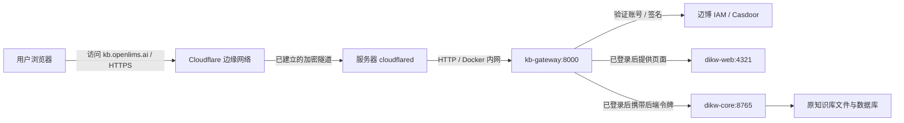

# 知识库 IAM 网关

当前状态（2026-10-03）：Cloudflare DNS 与 `kb.openlims.ai → http://kb-gateway:8000` 路由已发布，浏览器确认 IAM 登录入口可达。客户知识库同期升级至 v0.10.0 / v0.6.8，原配置不再兼容；**完整知识库访问尚未验收，项目导航切换已自动回滚**。本目录保留第一阶段独立网关实现，后续以 [原生知识库迁移交接](../knowledge-native/README.md) 为准。旧候选状态快照已过时，不直接重复执行本页历史切换命令。

| 项目 | 配置 |
|---|---|
| 目标入口 | `https://kb.openlims.ai`，无 hash 时自动打开 `#mb-web` 论文知识库 |
| 网关目录 / 容器 | `/home/prometheus/mb-kb` / `mb-kb-kb-gateway-1` |
| 当前网关镜像 | `mb-kb:kb-iam-20261003T012525Z` |
| 镜像 ID | `sha256:cfaa4f6ee0cd215029c3824c63a679e66e62adf765192500b2267ee0b4eed2c5` |
| 网关内网 / 本机端口 | `http://kb-gateway:8000` / `127.0.0.1:18083` |
| IAM 业务组织 / 应用 | `mabpharm` / `admin/mb-kb`（独立于项目应用 `mp-pm`） |
| IAM 回调 / 退出回跳 | `https://kb.openlims.ai/auth/callback` / `https://kb.openlims.ai/login` |
| 网关网络 | `mb-pm-v2_internal` + `dikw_dikw_net`，与现有服务通过固定内网地址通信 |
| 知识库原服务 / 数据 | `/home/prometheus/dikw`；前端 `dikw-web:4321`，原核心 `dikw-core:8765` 和 `/base` |

## 1. 完成域名发布和验收

在 Cloudflare 当前承载 `pm.openlims.ai` / `iam.openlims.ai` 的隧道新增一条 **Published application route**：

- 隧道 ID：`9fd0232f-e065-4925-8c17-98e73f2ba463`。
- 主机名：`kb.openlims.ai`；Service Type：`HTTP`；URL：`kb-gateway:8000`。
- 必须指向 IAM 网关，**不要指向 `dikw-caddy` 或 `dikw-core`**。
- 由该路由生成 DNS CNAME；检查没有重名记录。新入口的登录由网关 IAM 负责，无需再配置邮箱验证码层。保留旧知识库的 Cloudflare Access 策略。

验收：未登录的 `/v1/health`、`/agent/sessions` 和静态资源均应为 401；访问首页应转向 IAM。用现有业务账号完成登录，确认论文列表、阅读、连接状态和“退出登录”，退出后 API 恢复 401。账号在 IAM 停用或删除后，最迟在下一次 60 秒身份检查失去访问权限；不应让用户填 DIKW 令牌。通过后按项目交接流程发布 `Sidebar.tsx` 和版本说明。

服务器当前验证结果：7 项独立安全 / 代理回归测试通过；网关实际连通 IAM，2 个启用账号状态核对通过；原知识库健康、页面列表接口返回 1,276 条记录；原前端可达。**这些检查不等于已通过真实用户 OAuth 登录。**服务器私有账号记录中的旧密码未通过登录，因此没有继续尝试，也没有重置客户密码或新建测试账号。

项目导航候选镜像已准备：`mb-pm:knowledge-iam-20261003T014023Z`，镜像 ID `sha256:5e065058243327f2fa7b94da3afa3dc67c51ad20687688be15d3ea920ec2b172`。源码包 SHA256：`2bdaa4bec2ef8a2bf66aeb6c555caa71926cc561741d4cf71ad3d4671d5f9bc8`。候选镜像 7 项检查通过，后端 56 个文件与当前镜像校验一致；还未切换。完成新域名和登录验收后，服务器执行已上传的受校验保护的切换脚本：

```sh
python3 /home/prometheus/mb-pm-v2/releases/mb-pm-knowledge-iam-switch.py \
  knowledge-iam-20261003T014023Z
```

候选源码和检查结果在项目服务的 `releases/knowledge-iam-20261003T014023Z`，切换失败会自动恢复当前 `knowledge-mbweb-20261002T155133Z` 镜像。若准备期间配置或镜像有其他变化，保护检查会停止，此时需重新核对和准备，不能绕过检查。

## 2. 账号和令牌规则

准入条件为：IAM `mabpharm` 组织中未停用、未删除、能成功登录的业务用户。知识库共享现有内容，不要求项目角色或项目成员绑定；`built-in/admin` 是 IAM 控制台管理员，不属于业务准入组织。

浏览器只保存 HttpOnly / Secure / SameSite cookie。网关使用授权码、PKCE S256、state、nonce、JWKS 签名、issuer 和 audience 校验；会话最长 1 小时。后端共享 DIKW 令牌由网关注入 `/v1/*` 和 Agent 连接参数，固定目标为现有核心，不向浏览器发送令牌。修改请求需匹配本站 Origin，退出还需会话 CSRF 值。

`config.private.json` 在客户服务器保存 `public_url`、`issuer`、`iam_internal_url`、`core_url`、`web_url`、`organization`、`client_id`、`client_secret`、`core_token`、`session_secret`。**不提交 / 不复制进公开文档**。文件 owner 为部署用户、group 为 10001，权限 640；以单文件只读挂载给容器。`auth-data` 为 uid / gid 10001、权限 700，仅保存加密会话和一次性登录事务，不含论文数据。后续发布保留现有凭据和 `session_secret`。

新域名与旧域名的浏览器存储独立；旧站仅存于浏览器本地的笔记 / 偏好不会自动迁移。已写入知识库服务器的内容仍使用原数据。

## 3. 修改和更新网关

本地修改 `app.py` / `bootstrap.js`，用已有后端虚拟环境运行：

```sh
backend/.venv/bin/python deploy/knowledge-gateway/test_gateway.py
```

仅上传该目录下的源码和 Compose 模板，不上传客户配置。在服务器的新 `releases/<新标签>` 目录构建；基础镜像沿用已验证的项目镜像依赖，更新基础镜像前重新核对依赖。命令中的标签需换成本次真实标签：

```sh
cd /home/prometheus/mb-kb
docker build -t mb-kb:<新标签> releases/<新标签>
docker run --rm --network none --entrypoint python \
  -v "$PWD/releases/<新标签>/test_gateway.py:/gateway/test_gateway.py:ro" \
  mb-kb:<新标签> test_gateway.py
# 测试通过后，仅将 .env 的 KB_IMAGE 改为 mb-kb:<新标签>
docker compose -p mb-kb --env-file .env -f compose.yml up -d --no-deps kb-gateway
docker inspect mb-kb-kb-gateway-1 --format '{{.State.Health.Status}}'
curl -fsS http://127.0.0.1:18083/health
curl -s -o /dev/null -w '%{http_code}\n' \
  -H 'Host: kb.openlims.ai' http://127.0.0.1:18083/v1/health
```

最后一个请求未登录应为 401；`/health` 只表示进程存活，业务依赖另做验收。原知识库前端 / Agent / 核心仍使用原版本，本次未将独立的 v0.6 核心或 v0.9.2 前端混入当前数据。

## 4. 回滚

后续更新失败时，将 `.env` 的 `KB_IMAGE` 改回上一已验证镜像，执行同一 `up -d --no-deps kb-gateway`；不回退知识库或 IAM 数据库。首次迁移失败时，项目菜单恢复旧 `https://maibo-dikw.i-am-holo.top/#mb-web` 入口；在 Cloudflare 移除本次 KB 路由后停止新增网关。不要把新域名直接转到未接 IAM 的旧 Caddy，不运行 `down -v`。

本次源码快照及校验在 `/home/prometheus/mb-kb/releases/kb-iam-20261003T012525Z`；配置与旧容器状态在同目录根的 `private-config-backups/kb-iam-20261003T012525Z`。知识库与项目原有 11 个容器 ID 均未改变。

## 5. 这次迁移涉及的技术知识点

这次“前移”是迁移访问入口：原来的论文前端、核心服务和数据库继续运行，由 `kb.openlims.ai` 经新 IAM 网关访问它们。项目菜单只是指向新入口；改菜单不能代替 DNS、隧道路由和登录接入。



**DNS 和隧道路由是两层配置。** DNS 让浏览器找到 Cloudflare；隧道的 hostname → service 规则再把请求交给正确的容器。同一隧道可以承载 `pm`、`iam`、`kb` 三个域名。通过控制台添加 Published application route 时，Cloudflare 会创建指向 `<隧道 UUID>.cfargotunnel.com` 的 DNS 记录；只有 DNS、没有对应路由，仍不能打开知识库。[Cloudflare 路由说明](https://developers.cloudflare.com/tunnel/concepts/routing/)

**不需要开放客户网站的入站端口。** `cloudflared` 从服务器主动连接 Cloudflare，浏览器请求沿既有隧道返回服务器。因此网站可以发布到域名下，而不用将服务器的 80 / 443 端口暴露到公网。浏览器至 Cloudflare 使用 HTTPS，隧道链路加密；本次最后一段 Docker 内网使用 HTTP，不等同于每一段都使用 HTTPS。[Cloudflare Tunnel 原理](https://developers.cloudflare.com/cloudflare-one/networks/connectors/cloudflare-tunnel/)

**IAM 管身份，网关管访问。** 网关将用户送到 `iam.openlims.ai` 登录；IAM 返回短期授权码，网关在服务器换取身份令牌，验证签名、签发者、接收应用和账号状态，再给浏览器安全会话 cookie。账号属于启用的 `mabpharm` 业务组织即可访问知识库，项目角色权限仍由项目系统单独判断。登录成功不等于给浏览器提供 IAM 应用密钥。[Casdoor OIDC 接入](https://casdoor.ai/docs/how-to-connect/oidc-client/)

**PKCE、state 和 nonce 分别防不同问题。** PKCE 将授权码绑定到本次发起登录的客户端；state 将回调绑定到当前浏览器发起的登录；nonce 用于确认身份令牌属于本次请求。它们与签名校验配合，不能只因为回调 URL 带有一个 `code` 就认定用户已登录。[PKCE 标准 RFC 7636](https://www.rfc-editor.org/rfc/rfc7636)

**IAM 令牌与 DIKW 令牌用途不同。** 前者证明用户身份；后者是知识库核心的服务访问凭据。用户只完成 IAM 登录，网关再为其代理请求携带服务器保存的 DIKW 令牌。原页面持续显示“连接中”，可能实际是健康接口返回 401；页面文案不能替代 HTTP 状态检查。

**Docker 服务名不是浏览器地址。** `kb-gateway`、`dikw-web`、`dikw-core` 通过 Docker 网络解析。隧道需要与网关处于同一网络，网关需要同时连上 IAM 与知识库网络。容器内的 `localhost` 指当前容器，不是另一个服务，也不是客户服务器宿主机。

**`#mb-web` 由浏览器处理。** URL 中 `#` 后的片段不会作为 HTTP 请求路径发送给服务器，原前端用它选择论文知识库界面。新入口在没有 hash 时自动设置 `#mb-web`，保留已有页面切换方式；不是把后端 API 移到 `/mb-web` 路径。[URI 片段 RFC 3986 §3.5](https://www.rfc-editor.org/rfc/rfc3986#section-3.5)

**换域名不等于搬走服务器数据。** 服务继续挂载原知识库文件和数据库；但 cookie、localStorage 和 sessionStorage 按域名 / origin 隔离，因此旧域名的登录会话及仅在浏览器本地保存的笔记不会自动跟到新域名。服务器已保存的知识库内容仍可读取。

定位访问问题时按顺序检查：

| 现象 | 优先核对 |
|---|---|
| 域名无法解析 | DNS 记录是否已创建，是否在正确的 Cloudflare 账号 / zone |
| 隧道或站点 502 | 隧道状态、hostname 路由、Docker 网络与 `kb-gateway:8000` 连通性 |
| IAM 回调失败 | KB 应用 client ID、精确回调 URI、issuer、PKCE / state / nonce；不要用项目应用的回调替代 |
| 未登录 API 返回 401 | 这是预期的访问拦截；登录后再验证 |
| 登录后仍显示“连接中” | `/v1/health` 的实际状态；网关是否携带有效 DIKW 令牌、是否连接原核心 |
| 修改菜单后仍打开旧入口 | 线上前端是否已切换到候选镜像，编译后的链接是否为新域名 |

进程健康、内网连通、外网路由和真实登录是四个不同验收层次。全部通过后，才能把这次迁移标为完成。
