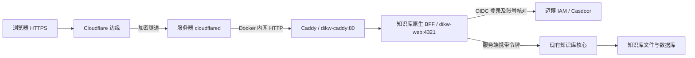

# 知识库新域名迁移交接

核对日期：2026-10-03。**Cloudflare 已按用户指定，将 `kb.openlims.ai` 改为直达现有 `dikw-caddy:80`；PM 菜单也已于本日 17:08（Asia/Taipei）部署为新链接。新域名完整登录验收尚未完成。** 上次知识库业务核对时，浏览器已跳到现有 IAM 应用，但回调仍为旧域名：`DIKW_WEB_PUBLIC_URL` 尚未同步。本目录的 v0.10.0 候选补丁属于历史准备方案，不用于当前已发布路由。

## 已确认的配置

| 项目 | 信息 |
|---|---|
| 新入口 | `https://kb.openlims.ai` |
| Cloudflare 隧道 | `Maibo-pm`，`9fd0232f-e065-4925-8c17-98e73f2ba463` |
| 已发布路由 | `kb.openlims.ai → http://dikw-caddy:80`；Path 空，其他设置保留默认；PM / IAM 两条路由未改 |
| 已创建 DNS | `kb.openlims.ai` CNAME → `9fd0232f-e065-4925-8c17-98e73f2ba463.cfargotunnel.com` |
| 当前入口网关 | `dikw-caddy`，与 `mb-pm-v2-tunnel-1` 共用 `mb-pm-v2_internal`；浏览器流量代理到 `dikw-web:4321` |
| 初始独立网关 | `/home/prometheus/mb-kb`，`mb-kb-kb-gateway-1`；仍运行，但不再承接新域名流量 |
| 最后核对的正式知识库 | `/home/prometheus/dikw`；`dikw-web` v0.11.0 / `dikw-core` v0.6.8，均 healthy；本次操作期间前端版本持续变化 |
| 当前知识库数据 | `/home/prometheus/dikw/base`；聊天卷 `dikw_v06_agent_sessions` |
| 正式知识库 IAM 应用 | `admin/dikw-kb`，业务组织 `mabpharm`；首页已为 `https://kb.openlims.ai`，允许新旧域名回调和退出回跳 |
| 知识库服务端公开地址 | `DIKW_WEB_PUBLIC_URL=https://maibo-dikw.i-am-holo.top`，仍需同步到新域名 |
| 项目线上镜像 | `mb-pm:knowledge-link-20261003T090717Z`；知识库链接为新域名，应用 healthy |

`https://kb.openlims.ai/#mb-web` 已跳转到 `dikw-kb` 的 IAM 登录页。内网通过 Caddy 核对 `/healthz` 返回 200、匿名 `/v1/health` 返回 401；**这不等于真实用户已经完成登录和论文阅读验收**。实际登录请求的 `redirect_uri` 仍为 `https://maibo-dikw.i-am-holo.top/web/auth/callback`。当前原生知识库通过 `kb_viewer` / `kb_editor` 角色映射准入，未匹配角色的登录用户会收到 403；所有启用业务账号默认可读的原始需求仍需处理。

## 当前剩余步骤

1. 将实际知识库运行配置的 `DIKW_WEB_PUBLIC_URL` 同步为 `https://kb.openlims.ai`，按现有部署流程仅更新知识库前端服务。IAM 已允许 `https://kb.openlims.ai/web/auth/callback` 和新域名退出回跳，不需要修改 PM / IAM 的 Cloudflare 路由。
2. 落实业务账号阅读权限：当前可为业务账号分配 `kb_viewer`，编辑账号用 `kb_editor`；若要求新增启用账号自动可读，须在原生知识库实现并验证该默认准入规则。
3. 用真实业务账号核对新域名登录回调、论文列表 / 阅读、连接状态和退出；同时确认匿名访问与普通用户写操作仍被拒绝。
4. PM 链接已按用户后续指示提前部署为 `https://kb.openlims.ai`，见 [上线记录](../parallel-test/releases/20261003-knowledge-link.md)；真实登录后的菜单点击仍需人工验收。旧 PM 候选容器快照不可复用。

## 人工验收清单

用浏览器无痕窗口打开 `https://kb.openlims.ai/#mb-web`，使用已有、获授权的业务账号测试。各项记录“通过 / 失败 / 待验”；只有进入 IAM 登录页不算完成业务验收。

| 检查 | 操作 | 通过标准 |
|---|---|---|
| 匿名访问 | 无痕窗口打开新入口 | 进入迈博 IAM 登录流程，未登录看不到论文和聊天数据 |
| 登录回跳 | 用业务账号登录，查看最终地址 | 回到 `kb.openlims.ai`，不回旧域名、不循环登录、不出现回调错误 |
| 论文阅读 | 打开 `#mb-web`，搜索一篇已知论文，查看详情及原有附件 | 原有内容可读取，与旧系统核对一致，无需填写服务访问令牌；不持续显示“连接中” |
| 账号准入 | 用普通启用业务账号验证；另用已有未分配 KB 角色的业务测试账号验证默认准入 | 均可阅读；若只有已分配角色的账号通过，不能认定“所有启用业务账号自动可读”已实现。缺少可用测试账号时记录待验 |
| 权限边界 | 用普通阅读账号核对写操作权限 | 可搜索和阅读，无编辑权限；维护者用测试请求确认未授权写接口返回 403，知识库内容不变 |
| 退出 | 点击知识库退出，再访问受保护页面 | 原知识库会话失效，重新进入 IAM 认证流程；IAM 单点登录仍有效时可能自动认证，需核对不是旧会话继续读取 |
| PM 菜单及其他入口 | 从 PM 的“相关系统 → 知识库”进入；再检查 PM 和 IAM | 菜单打开新 KB 域名；PM / IAM 原入口及功能正常 |

维护者补充核对：`DIKW_WEB_PUBLIC_URL` 为新域名、实际授权请求回调为 `https://kb.openlims.ai/web/auth/callback`；新入口的匿名数据 API 为 401，登录阅读接口成功，未授权写入为 403。验收资料保留最终页面截图和检查结果，不收集密码、Cookie、授权码或服务令牌。

**截至上次知识库业务核对，登录回跳新域名和所有启用账号默认准入两项未完成。PM 新链接已部署并校验；登录后的菜单点击及其余业务项目仍需真实账号验收。**

## 历史候选兼容方案（暂停，不用于当前路由）

已按 v0.10.0 的原生 OIDC / BFF 实现准备新入口网关，继承其前端、服务端令牌代理、读写权限和按用户隔离的聊天会话。正式前端随后升级为 v0.11.0，当前补丁尚未适配和验证该版本。补丁增加显式选项 `DIKW_WEB_DEFAULT_VIEWER_OWNER=mabpharm`：

- OIDC 签名 / issuer / audience / state / nonce / PKCE 验证成功后，通过应用凭据在内网实时核对该用户 UUID。
- 业务组织中未停用、未删除的用户默认获得阅读权限；现有 `kb_editor` 继续拥有编辑权限，普通用户不自动获得编辑权限。
- 最长会话 1 小时；每隔 60 秒重新核对账号，IAM 不可用时拒绝访问，停用 / 删除后清除会话。
- 新客户端使用 `admin/mb-kb`，回调改为 `https://kb.openlims.ai/web/auth/callback`，退出回跳为 `https://kb.openlims.ai/`。原 `dikw-kb` 应用不改。
- 新网关默认打开 `#mb-web`，保持论文知识库入口。沿用当前知识库文件与聊天卷，不导入旧快照。

补丁和测试源码在本目录；客户完整知识库源码留在服务器。脚本只在 `mb-kb/releases/<标签>/source` 副本打补丁，不修改原 `web-src`。当前 3 个业务账号通过实际 `owner + userId` 查询核对，确认组织、UUID、停用和删除字段一致；这不等于已通过真实用户 OAuth 登录。本方案**尚未完成构建验证及发布，不应当作已上线功能**。

## 历史候选构建说明（不可直接用于当前版本）

先确认其他知识库升级已经结束，重新核对实际容器名、镜像、数据挂载和核心地址；不要恢复已退出的旧容器，也不要绕过状态保护。当前构建脚本锁定 v0.10.0，已因线上变为 v0.11.0 而停止。维护者须先检查新版源码与原生认证行为、适配补丁及测试，并在核对完成后更新构建的源码路径和基础镜像约束；不要只删除断言或改版本号。

服务器补丁目录：`/home/prometheus/mb-kb/native-patches`。完成新版适配后，构建脚本要求传入已确认的实际容器名：

```sh
python3 /home/prometheus/mb-kb/native-patches/build-native.py dikw-web dikw-core
```

仅当脚本输出 `NATIVE_BUILD_COMPLETE`，且 lint、全量类型检查、全部身份模块测试和服务端构建通过时，才有可用候选。它会生成唯一标签及 `build-summary.json`，不切换服务。基础镜像必须绑定最终核对的版本；原知识库发生变化会使保护检查失败。当前没有通过全部验证的原生候选镜像。构建使用锁定依赖及其完整性校验，下载源为 npm 镜像站。

确认候选与当前状态仍一致后，再使用其**真实标签**执行：

```sh
python3 /home/prometheus/mb-kb/native-patches/switch-native.py kb-native-真实时间戳
```

切换脚本备份新增网关配置和 KB 应用回调，替换新增 `mb-kb` 网关，保护其他容器状态；失败会恢复新增网关与回调。它保留原知识库站点、核心及存储。私密环境复制仅发生在客户服务器，保存为 `native.runtime.private.env`，权限 600，禁止提交或输出。新网关健康路径为 `/healthz`。

验收须覆盖：匿名 API 为 401、真实业务账号登录、论文列表与阅读、连接状态、普通用户写操作为 403、退出后 API 为 401，以及停用检查。不得为验收擅自新增账号或重置客户密码。核对实际静态页面中不包含 IAM 应用密钥 / DIKW 令牌。

新入口通过后，重新准备 PM 前端发布及容器状态快照，再上线 `Sidebar.tsx` 和版本说明。旧候选 `knowledge-iam-20261003T014023Z` 的容器快照已过时，**不能直接重复执行旧切换脚本**。PM 运行配置与数据库保持现状。

## 技术知识点



1. **DNS、隧道、应用是三层。** DNS 指向 Cloudflare，hostname 路由选择服务器内的服务，应用再验证登录。只有改菜单或建 DNS 不能让知识库可用。同一隧道承载 PM / IAM / KB；服务器通过出站连接发布网站，不需要开放入站 80 / 443。浏览器至边缘与隧道加密，本次 Docker 内网最后一段使用 HTTP。[Cloudflare Tunnel](https://developers.cloudflare.com/cloudflare-one/networks/connectors/cloudflare-tunnel/)、[路由说明](https://developers.cloudflare.com/tunnel/concepts/routing/)
2. **IAM 管身份，BFF 管浏览器请求。** 用户在 IAM 登录，知识库服务端换取并校验身份令牌，再用安全 Cookie 维持会话；核心 DIKW 令牌只在服务器代理时使用。用户不用填写服务令牌，IAM 应用密钥不下发到浏览器。[Casdoor OIDC](https://casdoor.ai/docs/how-to-connect/oidc-client/)
3. **域名更换必须同步回调和 Origin。** 新域名、应用 `PUBLIC_URL`、IAM 允许的精确回调、退出回跳及写请求 Origin 必须一致；只改 DNS 会造成旧域名回跳或 CSRF 拦截。PKCE 将授权码绑定到登录发起方，state / nonce 绑定本次浏览器登录和身份响应。[PKCE RFC 7636](https://www.rfc-editor.org/rfc/rfc7636)
4. **容器名与版本可能一起变化。** Docker 服务名用于内网解析，`localhost` 指当前容器。升级后令牌、接口和数据目录都可能变化，必须核对实际版本；不能只看到进程 healthy 就认定内容可用。
5. **`#mb-web` 是前端路由。** `#` 后的片段不会发给服务器，浏览器用它选择论文界面。换域名也会隔离 Cookie / 浏览器本地存储，服务器文件和数据库则需保持实际数据挂载。[URI 片段 RFC 3986](https://www.rfc-editor.org/rfc/rfc3986#section-3.5)

故障定位顺序：DNS → Tunnel 路由 → Docker 连通性 → IAM 回调 / 身份 → DIKW 令牌及版本 → 实际业务页面。机器命令行请求可能被 Cloudflare 返回 403，必须结合正常浏览器验证，不应为了验收关闭 Cloudflare 防护。
