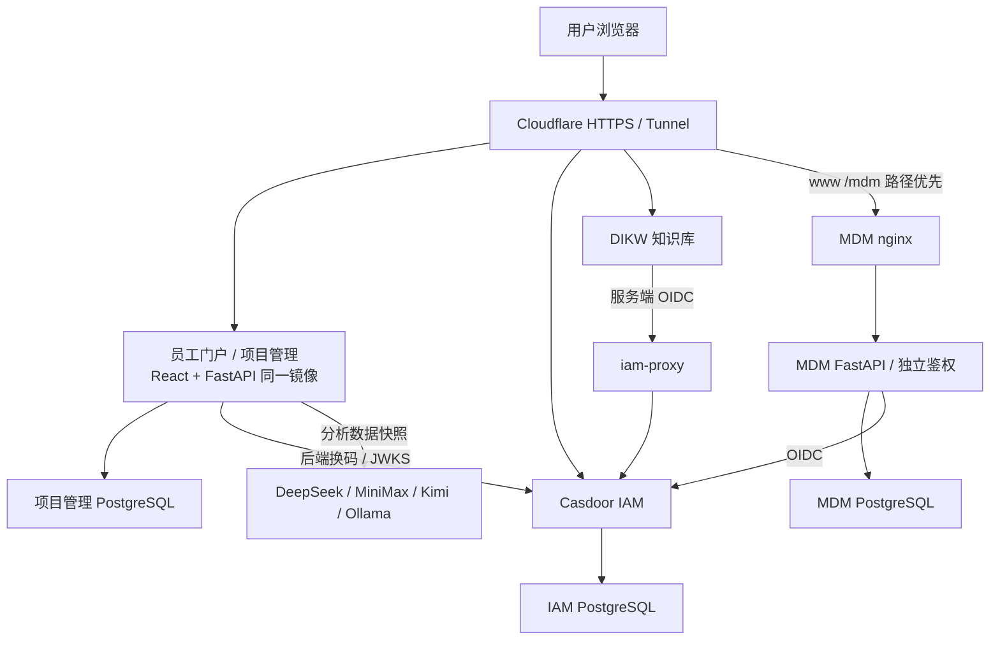

# 架构说明

本轮 Auto 开发预览的路径与数据边界见文末「自动问答与公开检索」；下文旧版先检索、无依据不生成的说明适用于知识库路径。

[返回 README](../README.md) · [配置与权限](configuration.md) · [部署交接](部署交接简明.md)

## 研究报告工作台数据流程（2026-11-02）

`RichBodySegment` 使用 TipTap 编辑，`reportMarkup` 清理粘贴 HTML 并转换 Markdown；报告 JSON 继续以 Markdown 保存正文，图片为受限的内嵌数据。`parent_id` 在既有章节 JSON 内表达最多 6 层结构，前后端同时检查不存在的父级、循环及整体大小。正文选择位置与 Markdown 偏移互相转换，异步 AI 采纳以报告、章节和文本版本校验，避免覆盖已经修改的选区。

迁移 `019_report_workbench` 在报告表增加 `pinned/tags`，新增按 `issuer + owner_id` 隔离的个人模板表和按报告归属授权的对话主题表。`solution_workbench.py` 管理五分钟节流的修改前快照、命名快照、单章恢复与主题修订号；报告保存、命名快照与恢复使用数据库 CAS，主题更新使用自己的修订号。快照复用既有版本表，恢复时重新授权引用，模板仅持久化章节标题和层级。删除主题留下逻辑墓碑，历史读取过滤，回答写入前再次检查，迟到响应不能复活已删除主题。

知识库向父应用提供用户实际选中的可见原文与受限长度的定位信息。父页面仍验证来源 origin/window，后端依据授权源、版本及原文重新检查选段；Markdown 可见文字只做保守归一化，不放宽来源权限或接受任意页码。报告内已有笔记入口读取统一 `/notes`；`GET /notes/{id}` 检查账号、issuer 和回收站状态，正文引用保存副本及受权限约束的站内链接。

`solution_word.py` 用标准库生成可编辑 OOXML，支持标题、列表、表格、PNG/JPEG、目录域和页码域，不抓取外部图片；`reportDocumentExport` 在浏览器渲染并分页生成 PDF，当前为页面图像。导入使用格式专用的延迟加载模块，限制文件、压缩包展开及正文大小；PDF 仅提取文本。HTTP 断开会在 AI 响应提交前检查，但不保证取消已发送的供应商请求。详细界限见[研究报告工作台](research-report-workbench.md)。下文早期本地预览说明为历史实现背景，发布状态见实际回执。

## 应用边界

顶部操作由 `src/components/application/ApplicationActions.tsx` 在工作台、项目管理及门户独立应用中复用，统一反馈来源、账号设置链接和主题切换。`src/components/ui/workbenchLink.css` 的 `app-workbench-entry` 单独提供深色返回工作台按钮，不改变研究报告主页等复用基础类的局部操作；独立 KB 仓库在 `maibo.css` 对齐相同色值。文案均为「应用工作台」。知识报告只移除草稿提交评审的界面入口，已有状态、历史、接口和数据模型保留。

知识报告在门户 `/solutions/*` 按需加载，复用门户登录，接口为 `/api/v1/solutions`。正文、配方、引用、评审与会话保存在应用数据库；个人知识资料与企业 DIKW 只读适配分开。资料浏览嵌入原 KB 的 `?embed=library` 视图，由 KB 自身会话管理上传、文件夹、标签和阅读；父页面只接收校验来源窗口及 origin 的版本化资料路径消息，引用或问答前仍通过报告后端重新读取授权资料。外部资料访问实时检查 IAM KB 角色，企业来源的权限随采用内容保留；详见[知识报告](knowledge-solutions.md)。

知识报告通过报告撰写模块内的语义化 `switch` 切换分栏与专注模式，首次默认分栏；开关分别位于分栏模块标题栏和专注模块工具栏，复用同一模式状态。报告名称和保存状态并入「撰写报告」模块标题行，移除独立摘要行；`ks-focus-writing` 仅调整现有工作区，辅助面板继续按工作区实际顶部定位，并避开模块工具栏。顶部「应用工作台」链接按当前模式选用 `/` 或 `/?preview=1`，避免开发预览返回时丢失演示标记。模式偏好独立于排列与目录设置，不写入报告业务模型；知识库 iframe 与 `InlineAssistantEditor` 保持原组件挂载。`reportTheme.css` 统一门户配色，`editorFormatting.ts` 处理 Markdown 格式与列表续写；编辑器用最小文字变更维护行内卡片锚点，并保存最多 100 步文字编辑撤销 / 重做记录，外部插入或卡片拓扑变化使旧记录失效。输入区自动扩展且滚动跟随光标，正文仅保留一个滚动区域；组合输入不截获快捷键或回车。本轮导航和布局调整已完成本地预览验证，未推送或部署。

本轮本地预览的正文内问答将卡片作为独立编辑器状态，不扩展后端 `Section`，也不把卡片序列化到章节正文或报告草稿。卡片通过现有 `client.ask` 请求问答，正式模式完成的回答保存为作者私有的 `SolutionAnswer`，由既有 history 接口读取并重新校验来源权限。卡片位置仅在本次打开报告期间保留；明确采纳时才将正文及引用一起交给既有保存和修订号校验。报告快照、定稿、导出及发布继续只使用已采纳的报告数据，不读取未采纳卡片。本轮本地预览已验证，未推送远程或部署生产。

本轮模块尺寸调整只属于前端显示状态：桌面四种网格排列的行列分隔线及窄屏堆叠的高度分隔线更新本地尺寸偏好，和报告业务数据、自动保存修订号分开。没有偏好时使用默认比例或高度，支持拖动、键盘调整及双击还原；切入专注模式不覆盖既有分栏尺寸，返回时恢复。尺寸变化沿用三个模块的稳定组件身份，知识库 iframe、编辑器与行内卡片不重新挂载。排列布局入口统一位于最顶栏，配置窗口仅通过研究助手内高亮的「AI模型设置」打开，移除重复入口。尺寸调整只涉及前端显示；文字润色接口见下文，均仅本地预览，未部署。

`ChapterTitleInput` 在标题本身接收编辑，离焦 / Enter 提交非空标题，空白或 Esc 回退，不让临时空标题进入保存。撰写页移除候选配方编辑器和专注配方入口，后端字段、历史与导出不变，正文保存继续携带既有数据；引用和章节操作继续维护绑定。

选中文字助手由 `SelectionAssistant` 显示浮动菜单与问答 / 润色窗口，portal 挂在应用根节点以避开模块滚动裁剪。选区按原有 textarea 的 UTF-16 偏移记录，润色替换交给编辑器的最小文字编辑路径，沿用卡片锚点调整与正文撤销；替换前比较打开窗口时的章节全文和当前正文，拒绝覆盖过期选区。异步窗口使用请求代次丢弃已关闭窗口的迟到结果，报告切换与权限状态另由父级再次检查。只选择或打开窗口不触发业务保存，生成沿用原问答的草稿保存检查。

`POST /api/v1/solutions/{id}/polish` 复用门户会话、同源校验、临时密码守卫、作者所有权与个人模型连接，仅允许草稿及已保存章节；前后检查报告现有证据访问。它是文字编辑服务，直接向生成模型发送所选文字和措辞偏好，不执行知识检索、不添加事实依据，也不写入 `SolutionAnswer`、正文或修订号。提示词要求保留数值、单位、引用和不确定性，客户端要求人工核对及明确采纳；输出不能当作事实验证。没有生成模型、仅检索模式、调用失败、空结果或超长结果均报错并保留原文。无需数据库迁移或新增环境变量，模型安全传输复用既有服务。本轮仅本地预览，未部署。

知识报告个人模型由 `services/solution_ai.py` 管理，使用迁移 `007` 的独立表 `solution_ai_settings`：复合主键为 IAM `issuer + owner_id`，配置整体通过 `core.security.seal/unseal` 使用 `APP_SECRET` 加密，另存 `revision` 进行数据库条件更新。读取只返回配置元数据及 `key_set`，不返回密钥；更新为整份配置的比较并交换，旧版本返回 409。接口复用门户身份、同源写保护与临时密码守卫，独立于 PM 全局模型配置文件和管理权限。

`GET/PUT /api/v1/solutions/ai/settings` 与 `POST /api/v1/solutions/ai/test` 位于动态报告路由之前；输入错误和上游失败均不回显密钥或原始响应。普通问答和行内卡片共用 `ask.model_profile_id`：未传时取个人默认，否则兼容全局配置；`system` 强制全局，`retrieval` 强制资料摘录，其余标识只查本人配置。模型选择在检索空结果分支之前校验，无效配置不自动降级。检索授权、证据过滤、有效引用编号与回答历史保持原约束，无依据不请求生成服务。

五类个人服务统一使用 OpenAI-compatible Chat Completions 的最小请求体 `model/messages/stream=false`，复用已有回答解析；不继承 PM 全局 MiniMax 的额外调参。个人连接单独校验 URL 和所有 DNS 结果，固定到已校验 IP，保留原 Host 与 TLS SNI / 证书验证，禁用代理和重定向。明确的本机、RFC1918 与 ULA 自托管地址可用，云元数据、链路本地、特殊地址及歧义 IP 不可用。DNS 耗时遵循系统解析器，不承诺整个调用严格在连接超时内完成。开发预览用独立 namespace 保存非秘密模型元数据，密钥与连接测试入口禁用，不连接真实模型。本轮仅本地预览，未部署；接口字段和地址来源见[个人模型配置](knowledge-solutions.md#个人模型配置)。

本仓库包含员工门户及 CMC 项目管理的 React 前端与 FastAPI 后端，另提供信息获取应用。
信息获取在门户 `/information/*` 独立挂载并按需加载，不依赖 PM 业务数据引导；复用门户登录及改密守卫。
信息获取使用 PostgreSQL 的独立元数据、正文和全局租约表；共享持久卷保存内容寻址 PDF。后台逐类检查、逐文件处理，通过签名服务桥接知识库 BFF，Core 令牌始终留在知识库。详见[数据流程和限制](information.md)。
IAM 使用 [mb-casd](https://github.com/OpenLimsAI/mb-casd) 的 Casdoor 配置；知识库 DIKW 是独立服务，其完整源码不在本仓库中。
`deploy/knowledge-gateway/` 与 `deploy/knowledge-native/` 保存历史接入及迁移准备材料，不能当作当前知识库源码或直接重新部署。
当前论文应用为私有 `OpenDIKW/dikw-mbweb`；客户样式及翻译持久化补丁见 [knowledge-translation](../deploy/knowledge-translation/README.md)。



上图描述生产系统的职责关系。PM 配置 `CASDOOR_INTERNAL_URL` 使用内网 IAM；
知识库的服务端 OIDC 经同名 TLS 代理访问 IAM，具体配置与信任关系维护在 IAM 仓库。
实际域名路由、运行镜像、备份和验收结果见部署交接，不由本图证明服务已上线。

2026-11-02 的 MDM 路径分流为 `www.openlims.ai/mdm/* → Tunnel → mdm-web:80`，保留 `/mdm` 前缀；页面和静态资源由 MDM nginx 承载，`/mdm/api/` 转发到其后端的 `/api/`。精确路径规则必须排在 `www` 无路径的门户规则之前；其余门户请求与 PM、KB、IAM 域名保留原目标。MDM 仍是独立部署、数据库、IAM 客户端和 `/mdm/` Cookie 会话，旧子域名以 307 跳转新主机，不因同域自动获得业务权限。镜像、备份及真实账号验收限制见[路径迁移记录](../deploy/parallel-test/releases/20261102-mdm-www-path.md)。

## 客户服务器运行快照

核对日期：2026-10-04（Asia/Taipei）。通过只读检查容器、网络、代理路由和存储元数据核对，未执行真实用户登录或业务验收。
以下为当日历史快照；2026-10-08 的增量状态见本节末尾，不能用旧镜像作为当前默认发布基线。
主机为 Ubuntu 24.04.4 LTS，16 个逻辑 CPU、约 16 GB 内存、约 98 GiB 系统盘；运行 10 个 Docker 容器。

| 部署栈 | 容器 / 职责 |
|---|---|
| `mb-pm-v2` | app、Casdoor、项目数据库、IAM 数据库、Cloudflare Tunnel |
| `dikw` | Web、Core、Caddy、知识库 PostgreSQL |
| `iam-proxy` | 知识库服务端 OIDC 的内部 TLS 代理 |

三个数据库均使用 PostgreSQL 18，数据各自持久化。知识库 Core 的数据库连接已核对；
原文件目录挂载于 `/home/prometheus/dikw/base`，Agent 会话另有持久卷，PM AI 设置使用独立持久卷。
PM 当前镜像为 `mb-pm:portal-20261003T194612Z`，DIKW Web 为 0.11.0、Core 为 0.6.8。

Tunnel 接收的四条域名路由为：www / pm → `app:8000`、iam → `casdoor:8000`、kb → `dikw-caddy:80`。
连接器日志显示使用 QUIC。业务诊断端口绑定回环地址，数据库不映射宿主端口；网站不依赖公网 80 / 443 入站监听。
`mb-pm-v2_internal` 连接 PM、IAM、Tunnel 及跨网代理，`dikw_dikw_net` 连接知识库服务，`iam-oidc` 专供 Web 与 IAM 代理互通。

配置了健康检查的 7 个容器均为 healthy，其余 3 个未配置健康检查。
当前 Docker 清单中未见旧 `mb-pm-app`，旧域名和历史数据迁移仍需单独确认。
两个 Caddy 实际版本为 2.11.3，但运行容器引用为 `caddy:2-alpine`，应在后续维护时统一固定标签或摘要。
系统和数据集中在一台主机，异机备份及恢复演练需另行核验。此快照不替代每次发布时的实时检查。

### 2026-10-08 增量核对（企业样式发布时）

当次核对共有 11 个运行容器：PM 栈 5 个、DIKW 栈 5 个、IAM 内部 TLS 代理 1 个；8 个配置健康检查的容器均 healthy，其余 3 个未配置健康检查。
PM / 门户镜像为 `mb-pm:project-levels-20261015T083222Z`（2026-10-15；IP 直连应急入口 `app-direct` 共用同一镜像）。前端托管：页面与非哈希文件 `Cache-Control: no-cache`，`/assets` 长期缓存。DIKW 已拆分论文知识库 `dikw-mbweb`（本次样式镜像 `maibo-20261008T004840Z`，业务基线 0.1.10）和管理工作台 `dikw-web:0.12.4`，Core 为 0.6.10。

网页请求路径是 `kb.openlims.ai → Tunnel → dikw-caddy:80 → dikw-mbweb:4321`；带 Bearer 的 `/v1/*` 仍转 Core，普通浏览器由论文应用 BFF 校验身份后代理。管理工作台使用回环入口 `http://localhost:4330`，需经 SSH 转发访问。
论文与工作台共享 Core 知识库，分别使用 IAM 客户端和会话卷；论文会话卷为 `dikw-mbweb-data`，原知识文件仍在 `/home/prometheus/dikw/base`。论文应用的服务端 OIDC 经 `iam-proxy`，保留既有 CA 信任。

四个 IAM 应用均已开启保留登录会话和自动登录，显式 Cookie 时限 168 小时；各应用独立会话和角色校验仍保留。SSO 配置核对、准确源码 / 备份与验收边界见 [10 月 8 日记录](../deploy/parallel-test/releases/20261008-knowledge-brand.md)。此次只替换论文应用前端，其余容器 ID、环境变量值和挂载保持原样。

### 2026-10-08 翻译持久化增量

论文应用当前镜像为 `dikw-mbweb:translation-20261008T012722Z`，同时更新前端与 BFF，精确依赖仍为 shared 0.1.4。
浏览器切换中英对照 → BFF 查询 `/web/papers/translation` → 读取卷内 `/data/mbweb/translations.sqlite`。
只有显式点击开始 / 重新翻译才由 BFF 经原有服务端翻译接口调用模型；完整结果成功后原子保存，按 issuer / Core、论文路径、语言和原文内容哈希校验复用。
该库保存共享论文译文，原文仍在 Core；原有 auth / agent SQLite、IAM 角色和其余 10 个容器不变。备份采用 SQLite 在线 API，不能遗漏 WAL。
具体权限、失败恢复与验证范围见 [发布记录](../deploy/parallel-test/releases/20261008-persistent-translation.md)。

## 技术栈与运行方式

- 前端：React 19、TypeScript、Vite、Tailwind CSS v3、Zustand、Axios。
- 后端：Python 3.11、FastAPI、SQLAlchemy 2、Pydantic 2、httpx、python-jose、cryptography。
- 数据库：生产部署使用 PostgreSQL，本地开发可用 SQLite；项目管理与 IAM 数据库独立。
- 开发：Vite 提供页面，经 `/api` 代理到 FastAPI，保持浏览器同源访问。
- 生产：多阶段 Docker 构建先编译前端，再将静态资源放入后端镜像，由 FastAPI 同源托管 SPA 与 `/api/v1`。

## 代码目录

```text
src/
├── pages/              门户与项目管理页面
├── components/         布局、控件及路由守卫
├── api/                请求与 snake_case / camelCase 转换
├── store/              身份、门户及业务状态
├── data/bootstrap.ts   项目数据引导与更新
├── lib/                域名分流、权限、关键路径、模板算法
└── mock/               演示数据与开发基线
backend/
├── app/api/            HTTP 接口与鉴权依赖
├── app/models/         SQLAlchemy 模型
├── app/schemas/        输入输出结构
├── app/services/       进度、财务、AI、IAM 等业务逻辑
├── alembic/            迁移文件
└── tests/              后端回归测试
docs/                   功能、配置、开发、部署与更新说明
deploy/                 环境配置及历史发布材料
```

## 登录与应用入口

登录页提交用户名 / 密码 → 后端生成 state / nonce / PKCE（`/login/start`）→ 浏览器直接向 IAM `/api/login` 提交凭据换授权码
（IAM 同时写入自己的登录会话，供单点登录；已有 IAM 会话时不带密码直接换码；浏览器连不上 IAM 或需两步验证时退回跳转 IAM 登录页）→ 打开回调 →
后端换取令牌并校验签名、issuer、audience 和身份 → 建立 HttpOnly 会话 Cookie。密码不经过本系统后端。
令牌加密保存在服务端，不交给前端 JavaScript，也不放在应用跳转 URL 中。

`src/lib/site.ts` 按域名选择界面：www 显示门户，pm 显示项目管理，本地开发默认组合模式。
门户只获取身份与应用准入清单，不加载项目数据；业务页面延迟加载，由各应用重新检查权限。
门户与 PM 使用独立客户端及业务会话，账号开通、角色与退出范围见配置文档。
门户「设置」（`/settings`）同样走门户会话：本人改用户名 / 密码（`/api/v1/portal/username`、`/password`）与 AI 设置（`/api/v1/portal/settings/ai*`，仅 admin / cmc_lead）；PM 不再有组织 / 设置页，`/api/v1/users` 只供团队与负责人选择。
门户「账号管理」走门户会话：`/api/v1/portal/accounts` → `services/accounts.py` 实时读写 Casdoor（`services/iam_admin.py`），同一请求内同步 PM `users` / `iam_identities`；IAM 写入失败不改 PM，新建中途失败会撤销已建的 IAM 账号。PM 首次登录时由 `core/security.py` 按同一规则（`services/members.py`）自动建成员，`/api/v1/users` 只读。

账号权限分为平台 `admin`、PM 业务角色、KB 角色三个范围，写入字段分别为 `platform_admin`、`pm_identity`、`kb_role`；PM 更新排除 `admin`，KB 只接受编辑授权。仅调整 KB、平台身份或公共资料时不会创建 PM 档案。账号管理写操作使用 PostgreSQL 事务 advisory lock（按组织）或 SQLite `BEGIN IMMEDIATE`，在多个进程间串行读改写 IAM 角色成员；成功后回读校验，中途失败尝试撤销本次 IAM 资料与角色变化，补偿失败显式报错。

账号管理保存角色后，在目标用户已有门户会话的加密元数据中更新 `catalogue_roles`，`/portal/me` 仅用它刷新入口目录。它不改变已签发令牌，也不用于 PM、KB 或账号管理操作授权；这些仍由 IAM 及应用后端校验。独立 KB 的旧会话无法由 mb-pm 清除，实际权限变化须重新登录相应应用并单独验收。

## 业务数据与计算

- 数据模型以用户、项目、项目成员、子项目、任务、依赖、模板、财务及基线为主。
- 项目页面先经 `/auth/me` 确认身份，再加载当前用户可见数据到前端运行时数组；API 更新后重新同步。演示数据与真实持久化数据属于不同模式。
- 更新任务状态、进度及实际工时后，`backend/app/services/rollup.py` 重算子项目及项目进度。
- 模板实例化由 `src/lib/instantiate.ts` 展开任务树，经 `/projects/import` 整包落库。
- 项目「编辑项目」页的结构部分经 `GET / PUT /projects/{id}/structure` 读取结构快照、提交编辑后的完整结构；`backend/app/services/structure.py` 在一个事务内比对增删改，校验结构版本（他人改过则拒绝）、删除保护（已开始或已录实际花费）与依赖成环，并写审计日志。前端草稿逻辑在 `src/lib/projectStructure.ts`，界面与模板结构编辑共用 `src/components/structure/StructureEditorKit.tsx`。
- 任务只能派给项目团队（负责人 + `project_members`）：任务新建 / 改派、结构保存时校验，仍有任务的人不能移出团队；整包导入、复制项目、更换项目负责人时自动把有任务的人留在团队中，启动时为老数据补齐（幂等），规则集中在 `backend/app/services/team.py`，前端对应 `src/lib/projectTeam.ts`。
- 任务在子项目内的先后由 `tasks.sort_order`（手动顺序）决定：编辑模式按列表位置保存，WBS 视图经 `src/lib/taskOrder.ts` 排列，后端统一用 `TASK_WBS_ORDER`；启动时为没有顺序号的老数据按原显示顺序补号（不改 `updated_at`）。
- 项目计划起止按任务实时派生（`backend/app/services/rollup.py` 的 `live_span`，与 `live_health` 同为读取时计算，不写库）：项目接口、结构快照、基线快照、复制平移与 AI 上下文统一使用；前端 `getProjectSpan` 同一规则。
- 复制项目经 `POST /projects/{id}/copy`，由 `backend/app/services/project_copy.py` 一个事务内照搬结构与计划、重置执行数据，可按新的计划开始整体平移日期。
- `src/lib/cpm.ts` 实现关键路径计算与延迟推演；推演只展示影响，不直接修改计划。
- `backend/app/services/scope.py` 集中定义项目与任务的可见范围；财务、基线等接口据此收窄数据。
- AI 基于数据库快照生成报告，保存来源指纹及实际提示词，数据变化后标记报告过期，不修改业务数据。

开发数据基线为 DMP v3.6 模板及 3 个示例项目（MAB-201/202/203，各 33 个任务），
`scripts/dump-seed.mjs` 将前端种子导出到后端 `app/seed/seed.json`。它不代表客户生产数据。
启动时使用 `create_all` 建表，并通过 `_ensure_schema()` 对部分旧列补充或加宽；数据库结构变更须单独规划迁移及备份。

知识报告文档导入在前端 `reportImport.ts` 校验扩展名、体积及正文长度，按需加载 Mammoth 读取 DOCX、PDF.js 读取 PDF，Markdown 使用 UTF-8 解码。PDF worker、中文 CMap 与标准字体均为本地构建资源；导入预览只渲染纯文本，不载入文档链接或图片。`ReportImportForm` 取消或换文件时废弃旧解析结果；确认后复用现有 `SolutionClient.create` 与保存冲突保护，新建草稿，不增加上传接口或数据表。

知识报告问答的 `conversation_id` 由迁移 `008` 加到原 `solution_answers`，按报告建立主题索引。`AskInput` 可带主题标识，未带时服务端为单次问题生成独立标识；历史接口回传该字段。连续问答只读取当前 IAM issuer、作者与报告下该主题最近六个问题作为理解上下文，不把历史生成内容用作证据。前端 `conversations.ts` 聚合主题并兼容旧回答标识，主题切换保留本次编辑中的问题草稿；后台结果按发出时的主题归属，采纳复用现有引用确认与撤销流程。正文末段以弹性高度填满撰写区域，不改变报告正文、章节、来源或历史存储。

工作台 `Workspace.tsx` 将应用依次分为 AI 智能、知识信息、业务管理、功能设置四个区域。业务管理放置项目管理、回音壁与人力资源；功能设置放置我的设置、AI 设置、主数据管理及按准入权限显示的账号管理，各卡片继续使用后台应用准入信息。笔记卡片进入门户 `/notes`，使用独立笔记客户端与数据表；人力资源仅为不可跳转的待开发占位。个人 AI 模型页 `/model-settings` 位于 PortalGate 内，与 AI 助手和研究报告共用 IAM namespace 及模型客户端，不加载 PM 数据或改变 `/ai-settings` 管理员配置。登录返回路由将其视为门户会话。研究报告/行业信息名称调整只涉及前端展示，内部 solutions/information 路由和浏览器存储键保持不变。

独立笔记由 `src/features/notes` 提供共享编辑弹窗、列表与选区捕获。正式使用门户 Cookie 访问 `/api/v1/notes`；`personal_notes` 按 IAM issuer/sub 隔离，无 KB/报告外键，不访问 Core。009 迁移新增表及索引，revision 乐观锁保护更新、软删除和恢复，UUID 创建重试不重复保存。预览使用独立的 `mberp:personal-notes:preview:v1:<namespace:user>` 浏览器键，保留旧 KB 数据。

笔记独立页面采用专用应用外壳，顶栏使用全局 `--app-header-background`，保留通用 `app-workbench-link` 返回动作。`NotesWorkspace` 的 app 模式把原有来源与回收站筛选放入侧栏，embedded 模式继续供行业信息复用，不重复嵌套应用导航；两种模式共用客户端、列表和编辑状态。`NoteEditor` 继续以 Portal 挂到 body，统一编辑样式并将保存区固定在可滚动正文之外。

工作台当前依次为 AI 智能、知识信息、业务管理、功能设置四个区域。AI 助手位于 PortalGate 的独立 `/assistant`，提问时可选择读取有权限的 KB 数据，不再连接 PM 数据。`AssistantApp` 管理任务选择、逐任务输入草稿和异步回复归属，结果以 Markdown 渲染并禁止 HTML/远程图片自动加载；`client.ts` 区分正式门户 API 和独立预览存储。模型设置共用研究报告个人配置，手动选择企业默认在窗口聚焦刷新后仍保留。

后端 `assistant_tasks` 按 issuer/sub 隔离，`assistant_messages` 保存有序问答、显式资料上下文与请求标识。产物由已保存的回答派生，不建立重复文本表。创建 UUID 和已完成请求支持重放，写操作采用 revision；生成前释放数据库读事务，返回后重新校验归属、回收站及版本，原子追加一对问答。010 迁移仅在隔离测试库验证。详见[AI 助手](ai-assistant.md)。

行业信息在原有结构样式之后加载 `informationTheme.css`，统一应用外壳、导航、卡片、表单与响应式阅读布局，所有规则限定在该应用下。来源弹窗保持稳定的焦点监听，并通过 ref 获取最新关闭处理，避免表单渲染时重新聚焦。仅表现层变更，既有采集、入库、个人笔记与权限接口继续复用。

统一笔记以门户 `personal_notes` 为唯一正文来源，知识库嵌入门户笔记界面。显式共享通过同事务 `note_wisdom_sync` 任务表及 PostgreSQL advisory lock 同步 Core，浏览器不再发布正式笔记的 Wisdom 副本。详见 [笔记数据流程](personal-notes.md)。

AI 助手选择知识库时，`assistant_tool_chat.py` 为本轮模型注册六个 DIKW 只读函数工具，由 `assistant_knowledge.py` 校验参数并复用 `solution_knowledge.py` 的固定 Core 连接、响应上限和实时 IAM 权限；函数调用通过 OpenAI/Ollama 协议串联，工具资料有预算并标记分页和截断。最终保存前再次校验 KB 角色。未选择知识库时继续普通文本对话；没有跨请求共享工具记忆，也不开放 shell、Core 写入或联网工具。详见[工具合同与限制](ai-assistant.md#dikw-查询工具复用本次更新)。

## 本地工作区核对

本地旧稿、重复副本与 main 的对应关系，以及 2026-10-31 生产核对快照，见[本地修改核对记录](verification/2026-10-31-local-reconciliation.md)。未提交条目不能直接作为待发布功能列表；实际版本与配置须在发布时重新检查。

个人助手的任务输入和返回结果不再包含 `project`，列表只按任务名称搜索；`data_sources` 只接受 `knowledge`。旧 `assistant_tasks.project` 列及预览记录中的历史归类值保留以避免破坏历史数据，但不参与当前接口、检索或模型上下文。


助手对话展示由 `Conversation.tsx` 按相邻消息的 `requestId` 配对，每轮独立标注编号与时间；不改变消息存储、模型调用或任务数据，未匹配的历史消息仍完整显示。

## 自动问答与公开检索

个人助手通过独立的项目只读目录适配接入项目管理，不恢复任务的项目归类字段。普通概念、明确仅知识库和公开搜索路径分别执行；两个数据源勾选仅表示许可，项目问题或明确联合问题才读取项目快照，返回有界概况及真实可见总数，不提供 PM 写入工具。实际项目或联合回答使用 `application` 标签，响应仅提供使用过的来源名称，内部项目范围不交给浏览器。

迁移 `015` 在个人消息保存实际来源和项目范围。模型返回后、历史详情、产物和完成请求重放重新核对权限；未截断目录允许仍可见项目的历史读取，截断目录的总数依赖完整范围，范围变化需重新提问。旧项目回答缺少可验证范围时安全拒绝读取，原记录不删除。纯知识库历史沿用原策略，联合回答还须验证知识库权限。

个人助手与研究报告共用 `services/answer_modes.py`，按本轮问题、显式限制、授权数据开关及同主题实际模式确定通用、知识库或联网路径。旧客户端未传模式时保留原行为；新版默认 Auto。报告指定资料或范围保持知识库限制。知识库段落额外经过主题相关性过滤，排除仅靠泛词匹配的无关证据。

`web_search.py` 仅向固定 Tavily Search API 发送当前问题所需内容，读取有界的服务返回正文或摘要，不发送报告全文、附件、任务指引或知识库正文。来源 URL 验证、引用编号验证、模式与来源持久化独立于模型输出；报告联网来源保存为作者隔离的不可变快照，采纳继续验证引用。`GET /api/v1/assistant/tasks/capabilities` 向门户会话返回服务就绪状态，不返回凭据。

迁移 `014` 为个人消息和报告回答增补请求模式、实际模式、说明及联网来源；旧记录保留为空，不补造来源。本轮仅开发预览和请求替身验证，未部署生产；详见[流程与边界](assistant-auto-search.md)。

## DeepSeek 官方搜索

个人助手与研究报告按当前选中模型解析本人的加密配置或明确的企业默认，能力接口和实际搜索共用同一解析与端点校验。`web_search.py` 在管理员启用后调用固定 DeepSeek Search 接口，并将 content/summary/snippet、日期与链接规范化为原有来源结构，再交给既有生成管线。第三方端点密钥不转发至官方，不读取其他用户或未选模型；Tavily 仅在显式配置时使用。请求只带公开检索词，不自动附带上下文、KB/项目正文或报告。原有引用验证、字节/文本预算、无结果与错误分类继续生效；预览不联网，无新增数据表。

## 任务状态与历史内容分别授权

个人助手的列表摘要提供 id/revision/title，前端据此独立选择删除目标，不先读取完整对话。trash/restore 保留门户身份、同源、issuer/sub 归属和 revision 并发校验，仅修改 deleted_at、revision、updated_at 并返回摘要。消息、上下文、产物与范围元数据不随状态响应返回；详情、问答、任务指引修改和已完成请求重放仍执行历史范围检查。旧项目历史无法核验时，本人可移至回收站或恢复，不能借此读到受限内容。

## 生产前端产物验证

标准 Docker 构建和外部预构建产物共用显式生产入口及 `build-info.json` 校验，记录实际解析后的公开构建参数、固定源码和静态文件摘要。候选产物同时经过匿名 Chrome 页面检查，验证真实编译包在 `/portal/me=401` 后仍允许编辑账号密码，服务健康检查与该交互检查各自保留。流程见[生产构建检查](production-build.md)。


## 知识源研究工作区 v3

知识源通过门户会话访问 v3 BFF，再使用既有签名、nonce 与时限协议连接知识库。知识库保留 Core/IAM 数据和逐次授权，浏览器不获得 Core 凭据。目录统计和服务端分页元数据与正文读取分开；全文缓存仅保存可重建文本和真实 hash，不充当第二份原件库。

共享文件夹、标签、元数据修订、上传回执、删除屏障沿用知识库持久数据。本人集合、归档规则、阅读、位置和模型回执使用 PM 既有 JSON 记录；本轮不新增 Alembic 迁移。来源 URL/DOI/PMID 收录复用原 reference worker，手动 PDF 使用独立上传协议和受保护归档。明确确认的 `manual-index` job 只调用绑定手动上传凭证的索引/状态接口；全局租约与 source 行锁防止两实例重复处理，不把新任务送入普通 import/status 委托。

研究工具从当前有权正文召回节选后按需使用统一模型服务，结果绑定身份、正文版本、问题和模型设置；保存真实请求/响应/Token 回执，不推算不存在的费用账单。详细契约、权限和 20 项范围见[知识源增强](knowledge-source-v3.md)，环境版本与备份回滚见[部署交接](部署交接简明.md)。

## 备份管理数据流

浏览器 `/data-backup` → 门户管理员鉴权 → HMAC签名的私网宿主适配器。适配器读取现有cron、固定纳管目录及历史归档清单，私有SQLite保存已核对元数据和删除审计。后台只扫描历史文件，不启动备份或恢复，不更改现有定时任务。Web镜像没有Docker socket、解密密钥或备份目录。

选中删除先由服务器绑定操作者、文件身份、容量和有效期生成预览；确认后持现有备份双锁复核，再逐个删除明确选中的普通文件，留下审计。正在备份、文件变化或最后可恢复副本保护会拒绝删除。详见[备份管理](data-backup.md)。
