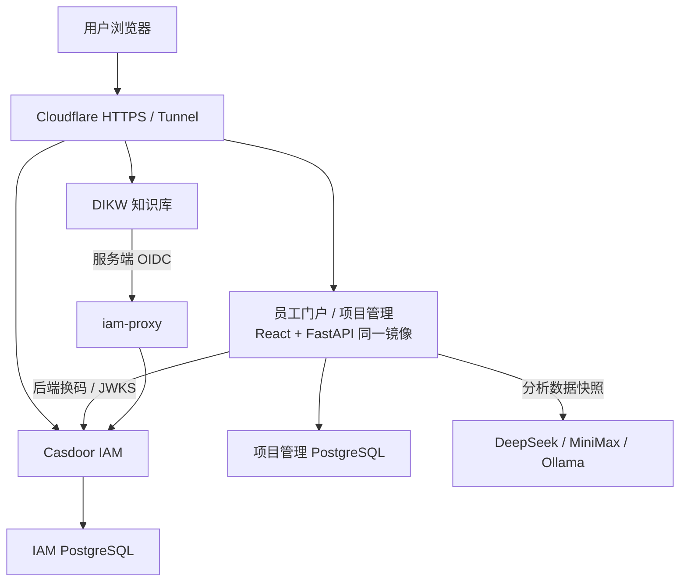

# 架构说明

[返回 README](../README.md) · [配置与权限](configuration.md) · [部署交接](部署交接简明.md)

## 应用边界

本仓库包含员工门户及 CMC 项目管理的 React 前端与 FastAPI 后端。
IAM 使用 [mb-casd](https://github.com/OpenLimsAI/mb-casd) 的 Casdoor 配置；知识库 DIKW 是独立服务，其完整源码不在本仓库中。
`deploy/knowledge-gateway/` 与 `deploy/knowledge-native/` 保存历史接入及迁移准备材料，不能当作当前知识库源码或直接重新部署。
当前论文应用为私有 `OpenDIKW/dikw-mbweb`；客户样式及翻译持久化补丁见 [knowledge-translation](../deploy/knowledge-translation/README.md)。



上图描述生产系统的职责关系。PM 配置 `CASDOOR_INTERNAL_URL` 使用内网 IAM；
知识库的服务端 OIDC 经同名 TLS 代理访问 IAM，具体配置与信任关系维护在 IAM 仓库。
实际域名路由、运行镜像、备份和验收结果见部署交接，不由本图证明服务已上线。

## 客户服务器运行快照

核对日期：2026-10-04（Asia/Taipei）。通过只读检查容器、网络、代理路由和存储元数据核对，未执行真实用户登录或业务验收。
以下为当日历史快照；2026-10-08 的增量状态见本节末尾，不能用旧镜像作为当前默认发布基线。
主机为 Ubuntu 24.04.4 LTS，16 个逻辑 CPU、约 16 GB 内存、约 98 GiB 系统盘；运行 10 个 Docker 容器。

| 部署栈 | 容器 / 职责 |
|---|---|
| `mb-pm-v2` | app、Casdoor、项目数据库、IAM 数据库、Cloudflare Tunnel |
| `dikw` | Web、Core、Caddy、知识库 PostgreSQL |
| `iam-proxy` | 知识库服务端 OIDC 的内部 TLS 代理 |

三个数据库均使用 PostgreSQL 18，数据各自持久化。知识库 Core 的数据库连接已核对；
原文件目录挂载于 `/home/prometheus/dikw/base`，Agent 会话另有持久卷，PM AI 设置使用独立持久卷。
PM 当前镜像为 `mb-pm:portal-20261003T194612Z`，DIKW Web 为 0.11.0、Core 为 0.6.8。

Tunnel 接收的四条域名路由为：www / pm → `app:8000`、iam → `casdoor:8000`、kb → `dikw-caddy:80`。
连接器日志显示使用 QUIC。业务诊断端口绑定回环地址，数据库不映射宿主端口；网站不依赖公网 80 / 443 入站监听。
`mb-pm-v2_internal` 连接 PM、IAM、Tunnel 及跨网代理，`dikw_dikw_net` 连接知识库服务，`iam-oidc` 专供 Web 与 IAM 代理互通。

配置了健康检查的 7 个容器均为 healthy，其余 3 个未配置健康检查。
当前 Docker 清单中未见旧 `mb-pm-app`，旧域名和历史数据迁移仍需单独确认。
两个 Caddy 实际版本为 2.11.3，但运行容器引用为 `caddy:2-alpine`，应在后续维护时统一固定标签或摘要。
系统和数据集中在一台主机，异机备份及恢复演练需另行核验。此快照不替代每次发布时的实时检查。

### 2026-10-08 增量核对（企业样式发布时）

当次核对共有 11 个运行容器：PM 栈 5 个、DIKW 栈 5 个、IAM 内部 TLS 代理 1 个；8 个配置健康检查的容器均 healthy，其余 3 个未配置健康检查。
PM / 门户镜像为 `mb-pm:task-order-20261013T172607Z`（2026-10-14；IP 直连应急入口 `app-direct` 共用同一镜像）。前端托管：页面与非哈希文件 `Cache-Control: no-cache`，`/assets` 长期缓存。DIKW 已拆分论文知识库 `dikw-mbweb`（本次样式镜像 `maibo-20261008T004840Z`，业务基线 0.1.10）和管理工作台 `dikw-web:0.12.4`，Core 为 0.6.10。

网页请求路径是 `kb.openlims.ai → Tunnel → dikw-caddy:80 → dikw-mbweb:4321`；带 Bearer 的 `/v1/*` 仍转 Core，普通浏览器由论文应用 BFF 校验身份后代理。管理工作台使用回环入口 `http://localhost:4330`，需经 SSH 转发访问。
论文与工作台共享 Core 知识库，分别使用 IAM 客户端和会话卷；论文会话卷为 `dikw-mbweb-data`，原知识文件仍在 `/home/prometheus/dikw/base`。论文应用的服务端 OIDC 经 `iam-proxy`，保留既有 CA 信任。

四个 IAM 应用均已开启保留登录会话和自动登录，显式 Cookie 时限 168 小时；各应用独立会话和角色校验仍保留。SSO 配置核对、准确源码 / 备份与验收边界见 [10 月 8 日记录](../deploy/parallel-test/releases/20261008-knowledge-brand.md)。此次只替换论文应用前端，其余容器 ID、环境变量值和挂载保持原样。

### 2026-10-08 翻译持久化增量

论文应用当前镜像为 `dikw-mbweb:translation-20261008T012722Z`，同时更新前端与 BFF，精确依赖仍为 shared 0.1.4。
浏览器切换中英对照 → BFF 查询 `/web/papers/translation` → 读取卷内 `/data/mbweb/translations.sqlite`。
只有显式点击开始 / 重新翻译才由 BFF 经原有服务端翻译接口调用模型；完整结果成功后原子保存，按 issuer / Core、论文路径、语言和原文内容哈希校验复用。
该库保存共享论文译文，原文仍在 Core；原有 auth / agent SQLite、IAM 角色和其余 10 个容器不变。备份采用 SQLite 在线 API，不能遗漏 WAL。
具体权限、失败恢复与验证范围见 [发布记录](../deploy/parallel-test/releases/20261008-persistent-translation.md)。

## 技术栈与运行方式

- 前端：React 19、TypeScript、Vite、Tailwind CSS v3、Zustand、Axios。
- 后端：Python 3.11、FastAPI、SQLAlchemy 2、Pydantic 2、httpx、python-jose、cryptography。
- 数据库：生产部署使用 PostgreSQL，本地开发可用 SQLite；项目管理与 IAM 数据库独立。
- 开发：Vite 提供页面，经 `/api` 代理到 FastAPI，保持浏览器同源访问。
- 生产：多阶段 Docker 构建先编译前端，再将静态资源放入后端镜像，由 FastAPI 同源托管 SPA 与 `/api/v1`。

## 代码目录

```text
src/
├── pages/              门户与项目管理页面
├── components/         布局、控件及路由守卫
├── api/                请求与 snake_case / camelCase 转换
├── store/              身份、门户及业务状态
├── data/bootstrap.ts   项目数据引导与更新
├── lib/                域名分流、权限、关键路径、模板算法
└── mock/               演示数据与开发基线
backend/
├── app/api/            HTTP 接口与鉴权依赖
├── app/models/         SQLAlchemy 模型
├── app/schemas/        输入输出结构
├── app/services/       进度、财务、AI、IAM 等业务逻辑
├── alembic/            迁移文件
└── tests/              后端回归测试
docs/                   功能、配置、开发、部署与更新说明
deploy/                 环境配置及历史发布材料
```

## 登录与应用入口

浏览器发起登录 → 后端生成 state / nonce / PKCE → 跳转 IAM → IAM 返回授权码 →
后端换取令牌并校验签名、issuer、audience 和身份 → 建立 HttpOnly 会话 Cookie。
令牌加密保存在服务端，不交给前端 JavaScript，也不放在应用跳转 URL 中。

`src/lib/site.ts` 按域名选择界面：www 显示门户，pm 显示项目管理，本地开发默认组合模式。
门户只获取身份与应用准入清单，不加载项目数据；业务页面延迟加载，由各应用重新检查权限。
门户与 PM 使用独立客户端及业务会话，账号开通、角色与退出范围见配置文档。

## 业务数据与计算

- 数据模型以用户、项目、项目成员、子项目、任务、依赖、模板、财务及基线为主。
- 项目页面先经 `/auth/me` 确认身份，再加载当前用户可见数据到前端运行时数组；API 更新后重新同步。演示数据与真实持久化数据属于不同模式。
- 更新任务状态、进度及实际工时后，`backend/app/services/rollup.py` 重算子项目及项目进度。
- 模板实例化由 `src/lib/instantiate.ts` 展开任务树，经 `/projects/import` 整包落库。
- 项目「编辑模式」经 `GET / PUT /projects/{id}/structure` 读取结构快照、提交编辑后的完整结构；`backend/app/services/structure.py` 在一个事务内比对增删改，校验结构版本（他人改过则拒绝）、删除保护（已开始或已录实际花费）与依赖成环，并写审计日志。前端草稿逻辑在 `src/lib/projectStructure.ts`，界面与模板结构编辑共用 `src/components/structure/StructureEditorKit.tsx`。
- 任务在子项目内的先后由 `tasks.sort_order`（手动顺序）决定：编辑模式按列表位置保存，WBS 视图经 `src/lib/taskOrder.ts` 排列，后端统一用 `TASK_WBS_ORDER`；启动时为没有顺序号的老数据按原显示顺序补号（不改 `updated_at`）。
- 复制项目经 `POST /projects/{id}/copy`，由 `backend/app/services/project_copy.py` 一个事务内照搬结构与计划、重置执行数据，可按新的计划开始整体平移日期。
- `src/lib/cpm.ts` 实现关键路径计算与延迟推演；推演只展示影响，不直接修改计划。
- `backend/app/services/scope.py` 集中定义项目与任务的可见范围；财务、基线等接口据此收窄数据。
- AI 基于数据库快照生成报告，保存来源指纹及实际提示词，数据变化后标记报告过期，不修改业务数据。

开发数据基线为 DMP v3.6 模板及 3 个示例项目（MAB-201/202/203，各 33 个任务），
`scripts/dump-seed.mjs` 将前端种子导出到后端 `app/seed/seed.json`。它不代表客户生产数据。
启动时使用 `create_all` 建表，并通过 `_ensure_schema()` 对部分旧列补充或加宽；数据库结构变更须单独规划迁移及备份。
