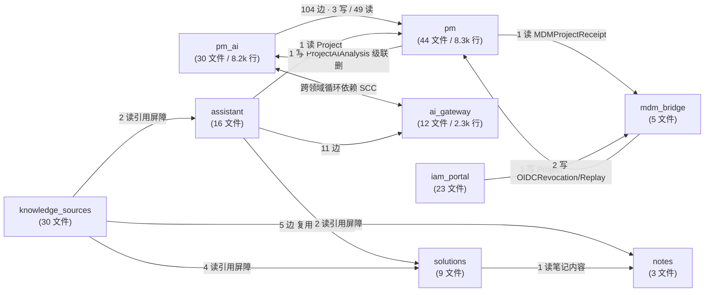
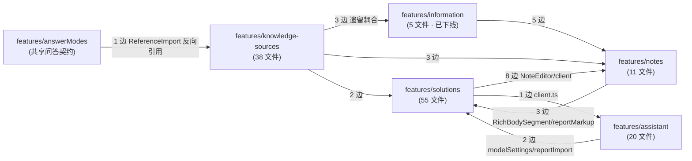

# mb-pm 领域边界与模块化演进方案

> **分析基准**：`OpenLimsAI/mb-pm`（`c58ab55`）｜ **覆盖范围**：后端 `backend/app/` 全量 **214** 个 Python 模块 + 前端 `src/` 全量 **350** 个非测试 TS/TSX 模块  
> **自动化护栏**：[`scripts/check-domain-boundaries.py`](../scripts/check-domain-boundaries.py) · 基线 [`scripts/domain-boundaries.baseline.json`](../scripts/domain-boundaries.baseline.json)（148 条冻结基线）· 单测 [`scripts/test_domain_boundaries.py`](../scripts/test_domain_boundaries.py) · CI 作业 `.github/workflows/ci.yml` (`domain-boundaries`)  
> **返回**：[README](../README.md) · [架构说明](./architecture.md)

---

## 1. 背景与核心结论

`mb-pm` 已从早期单一 CMC 项目管理工具演进为承载 **11 个业务域 + 1 个共享内核（Kernel）** 的统一工作台单体仓库（去重有效代码 ~17.6 万行，含测试）。经全量 AST 静态导入分析与前端 ES 模块静态依赖扫描，当前仓库存在以下 **四类结构性耦合热点**：

| 指标维度 | 实测数量 | 核心结论 |
| --- | ---: | --- |
| **跨领域直接写他域 ORM 模型** (`be-cross-orm-write`) | **7 处** | 集中在 `pm_ai -> pm`（3 处）、`iam_portal -> mdm_bridge`（2 处模型归属错位）、`mdm_bridge -> pm`（1 处）及 `pm -> pm_ai` 级联删除（1 处） |
| **跨领域直接读他域 ORM 模型** (`be-cross-orm-read`) | **92 处** | `pm_ai -> pm` 占 **54 处**（58.7%，含 PR #244 新增 `pm_ai_review_context.py`）；其余主要为各域直查 `iam_portal.{User,IAMIdentity}`（25 处）与 `knowledge_sources -> solutions/notes/assistant`（8 处） |
| **后端层级倒置（`services -> api`）** (`be-service-imports-api`) | **18 对模块**（19 条语句） | `agent_actions` / `pm_ai_changes` / `project_ai_actions` / `structure` 反向导入 `api/v1/{tasks,planning,pm_management,task_collaboration}`；知识源 V3 服务反调 `api/v1/knowledge_sources` |
| **后端循环依赖（Tarjan SCC）** | **7 个环**（含 **1 个跨领域环**） | 跨领域环：`services/ai.py (pm_ai)` ↔ `services/organization_ai.py (ai_gateway)` ↔ `services/solution_ai.py (ai_gateway)`；另有 6 个域内环 |
| **后端 `models -> services/api` 违规** | **0 处** | 数据模型层保持单向纯净，继续零容忍锁定 |
| **前端同级特性域互引** (`fe-cross-feature`) | **27 条边**（排除共享 `answerModes`） | 存在 3 组双向环：`solutions ↔ notes`、`solutions ↔ assistant`、`answerModes ↔ knowledge-sources`；且 `knowledge-sources` 仍耦合已下线的 `features/information` |
| **前端非 PM 域直引 PM / PM-AI** (`fe-non-pm-imports-pm`) | **3 条边** | `AISettingsPanel -> api/ai.ts`、`lib/accountAdmin.ts -> mock/dictionaries.ts`、`pages/AISettings.tsx -> lib/projectAssistantNavigation.ts` |

> **总体架构主张**：现阶段**不建议盲目拆分为分布式微服务**（避免多库分布式事务与运维复杂度倍增），而是实施 **模块化单体（Modular Monolith）**：以 **冻结存量债务 + 阻断新增越界（CI 棘轮门禁）** 立即止血，再分三阶段抽离领域端口（Port/Service）与公共前端契约包，为未来独立拆出「研究工作室 / 知识源」或「项目 AI 引擎」保留清晰接缝。

---

## 2. 12 域模块版图与静态规模分布

| 领域标识 | 业务职责 | 后端文件数 | 前端非测试文件数 | 归属 ORM 模型（`backend/app/models/`） |
| --- | --- | ---: | ---: | --- |
| `kernel` | 共享基础设施（配置、加解密、DB、中间件、枚举、审计日志、通用布局与 UI 原语） | 31 | 28 | `enums.py`、`audit_log.py` |
| `iam_portal` | Casdoor OIDC 登录、门户会话、账号管理、用户目录与密码策略 | 23 | 32 | `iam.py`、`portal.py`、`user.py` |
| `pm` | CMC 项目管理核心（项目/子项目/WBS/里程碑/依赖/协作/模板/基线/财务/排期/台账/视图） | 47 | 128 | `project.py`、`task.py`、`task_collaboration.py`、`template.py`、`template_upgrade.py`、`baseline.py`、`finance.py`、`planning.py`、`pm_management.py`、`pm_view.py` |
| `pm_ai` | 项目 AI 分析、分步工作流、草稿变更回执、外部 Agent 提案与事件发布 | 32 | 7 | `ai.py`、`pm_ai.py`、`pm_ai_changes.py`、`project_ai_work.py`、`agent_proposal.py`、`agent_events.py` |
| `ai_gateway` | 组织共享模型注册表、个人模型配置、Auto 问答路由与联网检索 | 12 | 10 | `organization_ai.py`、`solution_ai.py` |
| `solutions` | 研究报告工作台（章节树、TipTap 编辑、引用溯源、快照、Word/PDF 导出） | 9 | 55 | `solution.py` |
| `assistant` | 个人 AI 助手（任务对话、DIKW 工具调用、项目只读目录与产物派生） | 16 | 20 | `assistant.py` |
| `knowledge_sources` | 知识源 V3（收件箱、分类文件夹、导入/归档、删除屏障与遗留行业信息存储） | 30 | 44（含 `information` 5） | `information.py` |
| `notes` | 独立「我的笔记」与 `note_wisdom_sync` 知识库同步 | 3 | 11 | `note.py` |
| `feedback` | 回音壁问题反馈、讨论串、投票与通知 | 3 | 12 | `feedback.py` |
| `mdm_bridge` | MDM 主数据项目创建回执、链接构造与委派对接 | 5 | — | `mdm_integration.py` |
| `data_backup` | 管理员数据备份目录查看与 HMAC 签名受控清理 | 3 | 3 | 无本地表（代理宿主机目录） |

---

## 3. 后端静态依赖分析与跨领域 ORM 热点剖析

### 3.1 后端跨领域核心依赖拓扑（排除 `kernel` 与通用 `iam_portal` 依赖）



### 3.2 全部 7 处跨领域直接写他域 ORM 热点（最高优先级解耦清单）

| # | 越界文件（来源域） | 目标 ORM 模型（归属域） | 实测写入行为（代码位置） | 架构风险 | 目标解耦方案 |
| --- | --- | --- | --- | --- | --- |
| **W1** | `services/oidc_logout.py` (`iam_portal`) | `OIDCRevocation` (`mdm_bridge`) | `db.add` / 实例化 / 改写 `row.revoked_before` (`L138-149`) | **模型物理归属错位**：OIDC 全局吊销表是纯 IAM 资产，因历史随迁移 `007_mdm_creation_logout` 上线而被放进 `models/mdm_integration.py` | **零业务风险迁移**：将 `OIDCRevocation` 迁入 `models/iam.py`（保留兼容 re-export 一版） |
| **W2** | `services/oidc_logout.py` (`iam_portal`) | `OIDCLogoutReplay` (`mdm_bridge`) | `db.add` / `delete(OIDCLogoutReplay)` (`L168-173`) | 同 W1，造成 `iam_portal -> mdm_bridge` 反向依赖 | 同 W1，迁入 `models/iam.py` |
| **W3** | `services/pm_ai_changes.py` (`pm_ai`) | `PMRegisterEntry` (`pm`) | 直接实例化 `PMRegisterEntry(...)`、`db.add`、修改 `row.revision` (`L412-420`)，同时反调 `api/v1/tasks.py` 写 `Task` | 绕过 `pm` 域台账服务边界与统一校验；PM 字段演进易被 AI 写路径漏改 | 在 `pm` 域抽离 `services/pm_management.py`（`upsert_register_entry`）和 `services/task_mutations.py`，由 `pm_ai_changes` 仅通过端口调用 |
| **W4** | `services/project_ai_actions.py` (`pm_ai`) | `Task` (`pm`) | 直接 `Task(**data.model_dump())` + `db.add(task)` (`L204-205`) | 绕过任务创建服务与团队/顺序号/校验不变量 | 统一收口到 `pm` 域 `services/task_mutations.py:create_task_record` |
| **W5** | `services/project_ai_actions.py` (`pm_ai`) | `PMRegisterEntry` (`pm`) | 直接构造并 `db.add(PMRegisterEntry(...))` (`L217-218`) | 与 W3 重复实现台账写入逻辑 | 统一收口到 `pm` 域 `services/pm_management.py` |
| **W6** | `services/mdm_integration.py` (`mdm_bridge`) | `Project` (`pm`) | 直接构造 `Project(...)` + `db.add(project)` (`L114-130`) | MDM 建项逻辑绕过 PM 项目初始化不变量（成员/默认配置/审计） | 在 `pm` 域提供 `services/projects.py:create_project_for_integration`，`mdm_bridge` 仅负责幂等回执与参数转换 |
| **W7** | `api/v1/projects.py` (`pm`) | `ProjectAIAnalysis` (`pm_ai`) | 删除项目时循环硬删：`for model in (ProjectFinance, ProjectBaseline, ProjectAIAnalysis): db.query(model)...delete()` (`L317-318`) | `pm` 删项目感知 `pm_ai` 内部表结构，且易遗漏 `PMAIRun`/`ProjectAIJob` 等新表 | 引入 `pm` 删除钩子 / 领域清理端口（如 `on_project_deleted(db, project_id)` 注册表），由 `pm_ai` 自行清理本域数据 |

> **补充隐性跨领域写入路径**：`services/agent_actions.py`（`pm_ai`）虽未直接 `db.add(Task)`，但通过反向导入 `api/v1/tasks.py`、`api/v1/planning.py`、`api/v1/task_collaboration.py` 与 `api/v1/pm_management.py` 执行真实 PM 写入。抽离 `services/task_mutations.py`、`services/task_collaboration.py`、`services/pm_management.py` 后可同时消除该组 `services -> api` 倒置。

### 3.3 跨领域直接读他域 ORM 热点汇总（92 处）

| 来源域 → 目标域 | 条数 | 代表文件与模型 | 根因与收敛方案 |
| --- | ---: | --- | --- |
| **`pm_ai -> pm`** | **54** | `pm_ai_context.py`（11 个 PM 模型）、`agent_projects.py`（9 个）、`ai.py`（7 个）、`agent_actions.py`（6 个）、`pm_ai_review_context.py`（5 个）、`pm_ai_changes.py`（4 个）、`pm_ai_agent.py`（3 个） | 各 AI 服务各自拼装 SQL 读取项目/任务/依赖/基线/台账/日历，查询口径重复 | 在 `pm` 域提供只读查询门面 **`services/pm_read_facade.py`**（如 `get_project_snapshot`、`list_scoped_tasks`、`get_register_entries`），`pm_ai` 只消费 DTO / 只读视图 |
| **业务域 → `iam_portal`** | **25** | `pm`（8 处）、`pm_ai`（10 处）、`assistant`（2 处）、`mdm_bridge`（2 处）、`solutions`（2 处）直接 `db.get(User)` / `select(IAMIdentity)` | 身份映射与成员信息解析散落在多个业务文件 | 在 `iam_portal` 暴露统一只读目录 **`services/identity_directory.py`**（`resolve_user_by_iam`、`batch_get_user_profiles`） |
| **`knowledge_sources -> solutions / notes / assistant`** | **8** | `knowledge_source_references.py`、`knowledge_source_changes_v3.py`、`api/v1/knowledge_source_library_v3.py` 直查 `KnowledgeSolution` / `SolutionAnswer` / `SolutionTopic` / `PersonalNote` / `AssistantTask` / `AssistantMessage` | 删除论文原文前的「引用屏障」由知识源侧直接穿透三域内部表扫描引用 | **控制反转（IoC）**：在 `kernel` 定义 `ReferenceGuardProtocol`，由 `solutions`、`notes`、`assistant` 各自实现并注册 `count_paper_references(db, paper_path)`，消除知识源对三域表结构的穿透依赖 |
| **`assistant -> pm`** | **1** | `services/assistant_projects.py` 直查 `Project` (`L74-77`) | 个人助手项目只读目录适配直接查询 `Project` 表 | 改为调用 `pm` 的 `services/pm_read_facade.py:list_visible_projects` |
| **`pm -> mdm_bridge`** | **1** | `api/v1/projects.py` 直查 `MDMProjectReceipt` (`L308-309`) | 删除项目前检查是否已绑定 MDM | 调用 `services/mdm_integration.py:has_mdm_binding(db, project_id)` |
| **`solutions -> notes`** | **1** | `services/report_collaboration.py` 直查 `PersonalNote` (`L233-234`) | 研究报告引用个人笔记时直接查询 `PersonalNote` | 在 `notes` 域暴露 `services/notes.py:get_owned_note_snapshot(db, issuer, subject, note_id)` |

### 3.4 后端层级倒置（18 对）与循环依赖（7 个 SCC）

1. **18 对 `services -> api` 反向层级倒置**（全部被 `be-service-imports-api` 规则冻结）：
   - **PM 写路径（12 对）**：`services/{agent_actions,agent_projects,pm_ai_changes,project_ai_actions,structure}.py` 反引 `api/v1/{tasks,planning,pm_management,task_collaboration}.py` 的核心函数（`apply_task_create`、`apply_task_update`、`apply_schedule_changes`、`record_activity`、`check_owner`、`register_view`、`acceptance_out`）。**根因**：大量核心业务逻辑留在 Router 文件中未下沉到 Service 层。
   - **知识源 V3（4 对）**：`services/{agent_knowledge,knowledge_source_exports_v3,knowledge_source_research_v3,knowledge_source_worker}.py` 反引 `api/v1/knowledge_sources.py` 的 `connected` / `library` / `pending_archive` / `paper_snapshot`。
   - **门户会话常量/辅助（2 对）**：`services/{feedback_workflow,oidc_logout}.py` 反引 `api/v1/portal.py`（如 `PORTAL_LOGIN_COOKIE`、`PORTAL_SESSION_COOKIE`）。
2. **7 个循环依赖簇（SCC）**：
   - **跨领域环（P1 优先破除）**：`services/ai.py (pm_ai)` ↔ `services/organization_ai.py (ai_gateway)` ↔ `services/solution_ai.py (ai_gateway)`——将加密传输与 Provider 连接原语抽至 `ai_gateway` 底层 `services/model_transport.py` 即可彻底单向化。
   - **域内环（6 个）**：
     - `iam_portal` 认证环：`api/deps.py ↔ api/v1/auth.py ↔ api/v1/portal.py ↔ services/{iam_sessions,oidc_logout,password_policy}.py`（抽离 `core/cookie_names.py` 与 `services/session_store.py` 即可拆解）
     - `knowledge_sources` V3 环：`api/v1/{knowledge_source_library_v3,knowledge_source_workspace_v3,knowledge_sources}.py ↔ services/{knowledge_source_exports_v3,knowledge_source_research_v3}.py`
     - `assistant` 环：`services/{assistant,assistant_artifacts,assistant_operations,assistant_requests}.py`
     - `solutions` 环：`services/{report_collaboration,solution_workbench,solutions}.py`
     - `pm_ai` 环：`services/{pm_ai_runs,pm_ai_workflow}.py`
     - `schemas` 环：`schemas/model_network.py ↔ schemas/solution_ai.py`
3. **`api -> models` 直接依赖现状（134 处）**：暂不纳入硬阻断，作为中期「瘦 Router、厚 Service」重构指标持续观测。

---

## 4. 前端静态导入依赖分析与耦合热点

前端 `src/`（350 个非测试 TS/TSX 文件）已通过 `src/features/` 形成了较好的特性目录雏形，但存在 **30 条需治理的越界导入**（27 条同级 `features/*` 互引 + 3 条非 PM 域直引 PM/PM-AI）：



### 4.1 前端四大耦合热点与目标重构

| 热点 | 具体越界边 | 根因 | 目标重构 |
| --- | --- | --- | --- |
| **F1：`solutions ↔ notes` 双向环** | `notes/NoteRichEditor.tsx` & `NotesAppWorkspace.tsx` 导入 `solutions/{RichBodySegment,reportMarkup}`；`solutions/*` 导入 `notes/{NoteEditor,NoteSelectionCapture,client,draft}` | 通用 TipTap 富文本与 HTML↔Markdown 清洗模块错放在 `features/solutions/` 下；`notes` 未提供公开 barrel (`index.ts`) | 1) 将 `RichBodySegment` + `reportMarkup` 上提至 `src/components/editor/`（属于 `kernel`）；2) `features/notes` 通过 `index.ts` 暴露受控公开契约，切断反向依赖 |
| **F2：`solutions ↔ assistant` 双向环** | `assistant/AssistantApp.tsx` 导入 `solutions/{modelSettings,reportImport}`；`solutions/api.ts` 导入 `assistant/client.ts` | 个人模型配置客户端与文档解析器（DOCX/PDF/MD）归属不清 | 将 `modelSettings.ts` 与通用文档导入工具上提至 `src/features/answerModes/`（或 `src/shared/ai/`）共享层 |
| **F3：`knowledge-sources` 耦合已下线的 `information` 与 `answerModes` 反向环** | `knowledge-sources/{KnowledgeSourceApp,SourceManager,api}` 导入 `features/information/api.ts`（3 边）；`answerModes/ReferenceImport.tsx` 反向导入 `knowledge-sources/api.ts` | 知识源 V3 演进时复用旧 `information/api.ts` 类型与客户端；参考资料导入弹窗放错目录 | 1) 将仍在用的接口迁入 `features/knowledge-sources/api.ts` 并彻底隔离待归档的 `features/information/`；2) 将 `ReferenceImport.tsx` 下沉或通过回调函数 props 注入导入器 |
| **F4：非 PM 域直引 PM / PM-AI（3 边）+ 守卫目录归位** | `components/settings/AISettingsPanel.tsx -> api/ai.ts`；`lib/accountAdmin.ts -> mock/dictionaries.ts`；`pages/AISettings.tsx -> lib/projectAssistantNavigation.ts`；另 `ProjectReadyGate.tsx` 物理路径在 `components/auth/` | 门户账号字典误用 PM 演示字典；旧管理员 AI 设置页耦合项目助手导航 | 1) 抽离共享组织字典至 `src/lib/orgDictionaries.ts`；2) 将 `ProjectReadyGate.tsx` 迁至 `src/components/project/` |

---

## 5. 三阶段模块化演进路线图（Modular Monolith）

| 阶段 | 时间窗口 | 核心目标 | 可量化验收标准（由 CI 基线数直接检验） |
| --- | --- | --- | --- |
| **Phase 1：止血与模型归位** | **立即 – 2 周** | 1. 启用 `.github/workflows/ci.yml` 中的 `domain-boundaries` 棘轮门禁并设为 Required Check<br/>2. 迁移 `OIDCRevocation` / `OIDCLogoutReplay` 至 `models/iam.py`（消 2 处 ORM 写）<br/>3. 消除 `services/ai.py ↔ organization_ai.py ↔ solution_ai.py` 跨领域环<br/>4. 消除前端 3 条 `fe-non-pm-imports-pm` 与 `notes -> solutions` 3 条反引（上提 `RichBodySegment`/`reportMarkup`） | `be-cross-orm-write`: **7 → 5**<br/>`be-cross-domain-cycle`: **1 → 0**<br/>`fe-non-pm-imports-pm`: **3 → 0**<br/>`fe-cross-feature`: **27 → ≤ 21** |
| **Phase 2：写路径收口与层级扶正** | **3 – 6 周** | 1. 在 `pm` 域抽离 `services/task_mutations.py`、`services/pm_management.py`、`services/task_collaboration.py`、`services/projects.py`<br/>2. `pm_ai_changes`、`project_ai_actions`、`agent_actions`、`mdm_integration` 全部改走 `pm` 服务端口<br/>3. `api/v1/projects.py` 删除项目改为触发领域清理回调，不再直删 `ProjectAIAnalysis`<br/>4. 下沉 `api/v1/knowledge_sources.py` 与 `api/v1/portal.py` 被 Service 反引的公共函数与常量 | **`be-cross-orm-write`: 5 → 0（清零！）**<br/>**`be-service-imports-api`: 18 → 0（清零！）** |
| **Phase 3：只读门面与引用屏障反转** | **7 – 12 周** | 1. 建立 `pm_read_facade.py`（统一服务 `pm_ai` 与 `assistant`）与 `identity_directory.py`（统一服务各域 `User`/`IAMIdentity` 查询）<br/>2. 引入 `ReferenceGuardProtocol` 反转 `knowledge_sources` 对 `solutions`/`notes`/`assistant` 的直接查表<br/>3. 前端 `features/*` 统一经各自 `index.ts` 公开契约通信，彻底剥离已下线的 `features/information/` | `be-cross-orm-read`: **92 → 0**<br/>`fe-cross-feature`: **≤ 21 → 0**<br/>后端具备按 `backend/app/modules/<domain>/` 物理分包或按需拆分独立进程的就绪度 |

---

## 6. CI 自动化边界检查脚本使用指南

仓库已内置零外部依赖（Python 3.9+ 标准库）的前后端自动化边界检查器：

```bash
# 1. 日常开发 / CI 棘轮检查（阻断任何新增越界，允许既有基线）
npm run check:boundaries
# 等价于：python3 scripts/check-domain-boundaries.py

# 2. 严格基线校验（若你顺手修掉了历史越界但忘记缩减基线文件，会提醒更新）
python3 scripts/check-domain-boundaries.py --strict-baseline

# 3. 运行边界检查器自身回归单测（验证 8 类规则均能准确拦截合成越界）
npm run test:boundaries
# 等价于：python3 -m unittest scripts/test_domain_boundaries.py -v

# 4. 全量债务审计（忽略基线，列出所有存量越界并导出 JSON 报告）
python3 scripts/check-domain-boundaries.py --strict --report-json /tmp/mb-pm-boundaries.json

# 5. 债务清理 PR 中缩减基线（严禁在未获架构评审批准时扩大基线！）
python3 scripts/check-domain-boundaries.py --update-baseline
```

### PR 评审铁律
1. **新增文件**：在 `backend/app/` 下新增不匹配既定前缀规则的文件时，CI 会报 `be-unclassified-file`，开发者须在 `scripts/check-domain-boundaries.py` 明确声明其归属域。
2. **基线只缩不涨**：任何功能 PR 不得向 `scripts/domain-boundaries.baseline.json` 追加新条目；若架构重构消除了存量越界，应在同一 PR 内同步执行 `--update-baseline` 锁定成果。
3. **跨领域写入红线**：所有新增对其他领域表的写操作必须经目标域 `services/` 公开函数或同事务领域端口完成，禁止跨模块 `db.add()` / `db.delete()` / 直接改属性。
